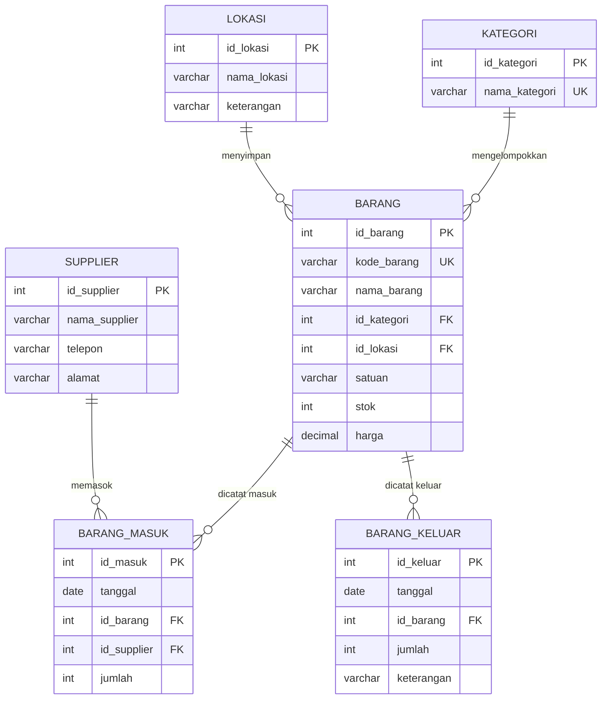

# 📦 Sistem Informasi Manajemen Inventaris Barang

Aplikasi web untuk mengelola persediaan barang: data barang, kategori, lokasi penyimpanan, supplier, serta pencatatan barang masuk dan barang keluar yang otomatis memperbarui stok.

> **Tugas Besar** — _isi nama mata kuliah_ · _isi nama dosen_ · Program Studi Informatika, Fakultas Teknik, Universitas Bengkulu

| | |
|---|---|
| **Kelompok** | _isi nomor/nama kelompok_ |
| **Tema** | Sistem Informasi Manajemen Inventaris Barang |
| **Demo online** | _isi link GitHub Pages, contoh: `https://username.github.io/nama-repo/`_ |

## 👥 Anggota Kelompok

| No | Nama | NIM | Peran |
|---|---|---|---|
| 1 | Muhamad Kesatrio Aditya Putra | _isi_ | _isi_ |
| 2 | Alldy Cahya Dinitra | _isi_ | _isi_ |
| 3 | Annisa Aurellia | _isi_ | _isi_ |

---

## ✨ Fitur

- **CRUD lengkap** (Create, Read, Update, Delete) untuk **Barang, Kategori, Lokasi, dan Supplier**.
- **Barang Masuk** dan **Barang Keluar**: setiap pencatatan otomatis menambah atau mengurangi stok barang.
- **Validasi stok**: barang keluar ditolak jika stok tidak cukup, stok tidak pernah menjadi minus.
- **Integritas data**: data yang masih dipakai tabel lain tidak bisa dihapus (foreign key `ON DELETE RESTRICT`), dan kode barang/kategori tidak boleh kembar.
- **Dashboard**: ringkasan jumlah barang, total stok, nilai persediaan, dan daftar barang yang stoknya menipis.
- **Laporan**: 7 query yang memakai `JOIN`, `COUNT`, `SUM`, dan `GROUP BY`.
- Pencarian cepat di setiap tabel, tampilan responsif, dan mendukung mode gelap.

## 🛠️ Teknologi

| Lapisan | Teknologi |
|---|---|
| Tampilan | HTML, CSS, JavaScript (tanpa framework) |
| Backend | PHP (PDO) sebagai API JSON |
| Database | MySQL / MariaDB |
| Server lokal | Laragon |
| Deploy | GitHub Pages (Mode Demo) |

## 📁 Struktur File

```
inventaris-tubes/
├── index.html        # kerangka halaman (HTML)
├── style.css         # tampilan
├── app.js            # logika tampilan + pemanggil API + Mode Demo
├── api.php           # perantara antara halaman web dan database (JSON)
├── koneksi.php       # pengaturan koneksi MySQL
└── inventaris.sql    # struktur database, data contoh, contoh CRUD & query laporan
```

Pemisahan tanggung jawab: **HTML/CSS/JS** untuk tampilan, **PHP** hanya sebagai perantara ke database, dan **SQL** berisi seluruh desain database.

---

## 🗄️ Desain Database

Database `db_inventaris_tubes` terdiri dari **6 tabel yang saling berelasi**.

### ERD



### Relasi dan Foreign Key

| Tabel anak | Foreign key | Tabel induk | Jenis relasi |
|---|---|---|---|
| `barang` | `id_kategori` | `kategori` | many-to-one |
| `barang` | `id_lokasi` | `lokasi` | many-to-one |
| `barang_masuk` | `id_barang` | `barang` | many-to-one |
| `barang_masuk` | `id_supplier` | `supplier` | many-to-one |
| `barang_keluar` | `id_barang` | `barang` | many-to-one |

Semua foreign key memakai `ON UPDATE CASCADE ON DELETE RESTRICT`.

### Aturan data (constraint)

- `kategori.nama_kategori` dan `barang.kode_barang` bersifat **UNIQUE**.
- `barang.stok >= 0` dan `barang.harga >= 0` (`CHECK`).
- `barang_masuk.jumlah > 0` dan `barang_keluar.jumlah > 0` (`CHECK`).

### Cara stok diperbarui

| Aksi | Efek pada stok |
|---|---|
| Catat barang masuk | stok **bertambah** sebesar jumlah |
| Catat barang keluar | stok **berkurang**; ditolak jika stok tidak cukup |
| Hapus catatan masuk | stok **dikurangi kembali**; ditolak jika sebagian barang sudah keluar |
| Hapus catatan keluar | stok **dikembalikan** |

Setiap pencatatan dijalankan dalam **satu transaksi database** (`beginTransaction`, `commit`, `rollBack`), sehingga catatan dan stok selalu konsisten. Stok di form edit barang dikunci agar hanya berubah lewat transaksi.

---

## 🚀 Cara Menjalankan

### Opsi 1: Lokal dengan Laragon (database MySQL asli)

1. Ekstrak folder proyek ke `C:\laragon\www\inventaris-tubes`.
2. Jalankan Laragon, klik **Start All** (Apache dan MySQL harus menyala).
3. Import database: klik tombol **Database** (HeidiSQL), pilih **File → Run SQL file...**, lalu pilih `inventaris.sql`. Tidak perlu membuat database dulu, file itu membuatnya sendiri.
4. Buka `http://localhost/inventaris-tubes` di browser.

Pengaturan koneksi ada di `koneksi.php` (bawaan Laragon: user `root`, password kosong). Kalau berhasil, badge di pojok kanan atas menampilkan **"Terhubung ke MySQL"**.

### Opsi 2: Online di GitHub Pages (Mode Demo)

GitHub Pages hanya menayangkan file statis, jadi PHP dan MySQL tidak berjalan di sana. Karena itu `app.js` otomatis beralih ke **Mode Demo**: seluruh fitur tetap bisa dicoba memakai data contoh yang disimpan di browser pengunjung (badge menampilkan **"Mode Demo"**).

1. Buat repository baru di GitHub, lalu upload isi folder proyek.
2. Buka **Settings → Pages**, pilih **Deploy from a branch**, branch `main`, folder `/ (root)`, lalu **Save**.
3. Tunggu 1-2 menit, website tersedia di `https://username.github.io/nama-repo/`.

> **Catatan:** data di Mode Demo bersifat lokal per browser dan bukan database sungguhan. Tombol **Reset data contoh** mengembalikannya ke kondisi awal. Database MySQL asli (tabel, PK/FK, CRUD) berjalan pada Opsi 1.

---

## 🔌 Endpoint API (`api.php`)

| Method | URL | Fungsi |
|---|---|---|
| `GET` | `api.php?t=<tabel>` | Ambil semua data tabel |
| `POST` | `api.php?t=<tabel>` | Tambah data |
| `PUT` | `api.php?t=<tabel>&id=<id>` | Ubah data (tidak tersedia untuk transaksi masuk/keluar) |
| `DELETE` | `api.php?t=<tabel>&id=<id>` | Hapus data |
| `GET` | `api.php?laporan=1` | Hasil 7 query laporan |

Nilai `<tabel>`: `kategori`, `lokasi`, `supplier`, `barang`, `barang_masuk`, `barang_keluar`. Nama tabel dibatasi daftar putih, dan semua query memakai _prepared statement_ untuk mencegah SQL injection.

## 📊 Query Laporan

| No | Laporan | Teknik |
|---|---|---|
| 1 | Daftar barang lengkap | `JOIN` 3 tabel |
| 2 | Jumlah barang dan total stok per kategori | `COUNT`, `SUM`, `GROUP BY` |
| 3 | Nilai persediaan per kategori | `SUM`, `GROUP BY` |
| 4 | Total barang masuk per barang | `JOIN`, `SUM` |
| 5 | Total barang keluar per barang | `JOIN`, `SUM` |
| 6 | Total pasokan per supplier | `JOIN`, `SUM` |
| 7 | Barang dengan stok menipis | `WHERE` |

Versi SQL murni dari semua query ini ada di bagian akhir `inventaris.sql`.

## 🖼️ Tangkapan Layar

_Tambahkan gambar di sini setelah proyek dijalankan, contoh:_

```md


```

## 🎬 Skenario Demo

1. Buka **Dashboard**, tunjukkan ringkasan dan barang stok menipis.
2. **Barang**: tambah, ubah, cari, dan hapus satu barang (CRUD).
3. **Barang Keluar**: catat jumlah melebihi stok, aplikasi menolak dengan pesan stok tidak cukup.
4. **Barang Masuk**: catat barang masuk, lalu cek stok di halaman Barang yang bertambah.
5. **Kategori**: coba hapus kategori yang masih dipakai barang, aplikasi menolaknya (bukti foreign key bekerja).
6. **Laporan**: tunjukkan hasil `JOIN` dan `GROUP BY`.

## 📝 Lisensi

Dibuat untuk keperluan tugas perkuliahan.
